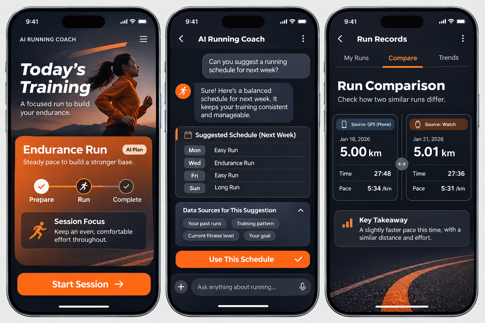

# 모바일 러닝 앱 디자인 조사와 적용 후보

- 조사일: 2026-11-20
- 상태: **제안**. 승인된 C2 시안과 `UI_UX.md`를 바꾸지 않는다.
- 목적: 최근 모바일 디자인 사례에서 PaceMate의 신뢰와 사용성을 높일 수 있는 표현을 찾고, 출시 전 검증할 후보를 고른다.
- 기준: `PROJECT_CONTEXT.md`, `PRD.md`, `UI_UX.md`, `DECISIONS.md`와 현재 구현. P0 일정과 안전·승인 규칙이 우선한다.

## 참고 이미지

이 이미지는 **AI 생성 콘셉트 이미지**이며 다른 앱의 실제 화면이나 승인된 시안이 아니다. 가운데의 접을 수 있는 근거 영역과 오른쪽의 나란히 비교하는 레이아웃만 아이디어 참고용이다. 이미지에는 실제 요구사항과 다른 운동 시작 버튼, 음성·첨부 버튼, 기기별 출처, 다른 날짜의 비교, 임의 수치와 결론이 포함되어 있다. 이 요소들은 구현 근거가 아니며, 이미지 속 영어 문구와 숫자를 제품에 사용하지 않는다. 왼쪽 화면도 기존 기능을 설명하는 시안이 아니다.

- 실제 사례 이미지: [Android Health Connect 출처 표시 예시](https://developer.android.com/static/health-and-fitness/health-connect/images/hc_basic_attribution.png), [출처 상세 설명 예시](https://developer.android.com/static/health-and-fitness/health-connect/images/hc_education_variation.png). 원문과 설명은 [Google의 데이터 표시 가이드](https://developer.android.com/health-and-fitness/health-connect/ui/data)에 있다. 해당 예시는 Android Health Connect에 관한 것이며, Apple 건강의 출처 정보를 현재 앱이 갖고 있다는 뜻은 아니다.
- 플랫폼 스타일 참고: [Google의 Material 3 Expressive 발표](https://blog.google/products-and-platforms/platforms/android/material-3-expressive-android-wearos-launch/)에는 실제 Android 화면 이미지가 있다. [Apple Design Awards 2026](https://developer.apple.com/design/awards/)에서는 The Outsiders와 Structured 사례를 볼 수 있다.

## 기존 설계와 구별되는 후보

C2는 이미 다크·주황 색상, 오늘의 훈련 카드, 상태 칩, 변경 전후 비교, 코치 말투, 접근성 및 모션 규칙을 정했다(`UI_UX.md` §2, §3, §6~§10). 아래는 그 요소를 다시 제안하는 것이 아니라 **기존 화면에서 아직 명세하지 않은 정보 표현**을 검토하는 목록이다. 효과는 가설이며 사용자 검증 전에는 확정할 수 없다.

| 우선순위 | 후보 | 새로 검토할 점 | 범위와 선행 조건 |
|---|---|---|---|
| 1 | 비슷한 기록의 비교 근거 | 현재 두 기록을 나란히 보여 주는 데 더해, 같은 날짜·거리·시간 등 실제 비교 근거와 집계에 사용된 기록을 짧게 표시한다 | T-305의 비교 화면을 기반으로 검토한다. 현재 API가 근거·대표 기록을 제공하는지 확인하고, 없으면 API 명세와 테스트가 먼저 필요하다 |
| 2 | 일정 변경의 확인 가능한 근거 | 기존 제안 카드의 이유 한 줄에 접을 수 있는 “어떤 정보를 확인했나요?” 영역을 더한다 | 실제 서버가 확인한 정보만 표시할 수 있을 때 시도한다. 현재 Proposal 응답에 근거 출처가 있는지 확인하고, 없으면 계약 변경과 개인정보 노출 검토가 선행된다 |
| 3 | 기록 가져오기 결과의 단계별 안내 | 가져온 수, 이미 처리했거나 저장할 수 없는 수, 거리가 없는 수, 실패 수의 의미를 구분하고 다음 행동을 표시한다 | 기존 가져오기 결과를 활용하는 화면 문구·배치 개선이다. 권한 거부를 단정하지 않고, 실패한 기록을 성공으로 표시하지 않는다 |
| 4 | 상태 변화에 반응하는 절제된 모션 | 기록 저장과 제안 승인 완료 시 상태 전환을 짧게 강조한다 | 기존 `UI_UX.md` §3.8 모션 시간과 동작 줄이기를 따른다. 실제 성공 응답 후에만 표시하며 성능과 두 플랫폼을 확인한다 |

### 1. 기록 비교의 근거와 집계 기준

- **문제 가설:** 비슷한 기록을 보고도 사용자는 왜 묶였는지, 어떤 기록이 이번 주 거리에 포함되는지 알기 어려울 수 있다.
- **제안:** 비교 화면의 각 기록에 기존 출처 이름과 거리·시간을 같은 순서로 보여 주고, 아래에 실제 판정에 맞는 근거를 한 줄로 적는다. 집계에 쓰인 기록에는 “이번 주 통계에 포함”을 표시한다. 예: “같은 날이고 거리와 시간이 비슷해요.” 시각 겹침으로 묶인 경우에는 그에 맞는 별도 설명을 쓴다. 대표 기록은 서버가 결정한 결과를 표시한다.
- **기존 설계와의 차이:** T-305는 비슷한 기록과 분리 동작을 제공한다. 이 제안은 **묶인 이유와 집계 대상의 가시성**을 추가한다.
- **주의:** 무조건 Apple Watch나 특정 러닝 앱 이름을 쓰지 않는다. 현재 저장된 출처가 `app`, `chat`, `healthkit` 수준이라면 그 수준에서만 설명한다. 사용자가 분리하면 통계가 바뀌는 것을 명확히 보여 준다. 연결된 기록을 우선하고 없으면 가장 긴 기록을 세는 기존 규칙을 바꾸지 않는다.
- **검증:** 동일한 달리기로 보이는 두 기록을 제시하고 “왜 묶였는지”와 “어느 기록이 통계에 포함되는지”를 참가자가 설명할 수 있는지 확인한다. 분리 전후 통계와 화면 낭독 순서도 확인한다.
- **근거:** Google은 건강 데이터에 출처와 설명을 표시하도록 안내한다. 이 문서는 Android용이므로 PaceMate의 iOS 구현에 그대로 적용되는 의무로 해석하지 않는다. [Google 가이드](https://developer.android.com/health-and-fitness/health-connect/ui/data).

### 2. 일정 변경 제안의 근거 펼치기

- **문제 가설:** 사용자는 전후 일정과 이유를 보더라도 어떤 정보를 반영했는지 확인하고 싶을 수 있다.
- **제안:** 기존 제안 카드의 이유 아래에 접힌 보조 영역을 놓고, 사용자가 펼쳤을 때 서버가 실제 사용했다고 보장하는 항목만 보여 준다. 예를 들어 실제로 여행 기간과 기존 일정을 전달받았다면 “요청하신 여행 기간 · 현재 훈련 일정”을 표시한다. 정보가 없으면 영역을 숨기거나 확인 가능한 정보가 없다고 안내한다.
- **기존 설계와의 차이:** 이미 정해진 이유 한 줄과 전후 비교는 그대로 둔다. 새 후보는 사용자가 요청할 때 확인할 수 있는 **입력 정보의 출처**다.
- **주의:** LLM의 추측이나 모델 내부 추론을 근거로 표시하지 않는다. 채팅 내용이나 건강 정보를 추가로 저장하거나 외부로 전송하지 않는다. 제안 수치와 내용은 Training Engine 및 검증된 서버 응답만 사용하고, 승인은 기존 버튼을 유지한다. 구현하려면 표시 가능한 데이터와 `API_SPEC.md` 변경 여부를 먼저 결정한다.
- **검증:** 참여자가 적용 전에 변경 내용과 실제 근거를 구별하고, 잘못된 근거가 없는지 확인할 수 있는지 관찰한다. 민감한 상세 내용을 기본 노출하지 않는다.
- **근거:** Microsoft의 인간-AI 상호작용 지침은 시스템의 행동 이유를 확인할 수 있게 하는 방식을 제안한다. 이는 일반적인 AI 설계 지침이며 PaceMate에서 효과가 입증됐다는 뜻은 아니다. [Microsoft Research](https://www.microsoft.com/en-us/research/blog/guidelines-for-human-ai-interaction-design/).

### 3. 가져오기 결과의 구체적인 다음 행동

- **문제 가설:** 여러 원인의 건너뛴 기록을 한 문장에 묶으면 다시 시도해야 하는지 판단하기 어렵다.
- **제안:** 기존 결과에 가져온 수, 거리 없는 수, 실패 수를 각각 구분하고, 실패가 있을 때만 다시 시도할 수 있는 안내를 보여 준다. 중복 ID와 저장할 수 없는 기록을 현재 서버가 구분하지 못한다면 합쳐서 표시하고 원인을 추측하지 않는다. 기록이 없을 때는 권한 문제로 단정하지 않고 건강 앱과 접근 설정을 확인하도록 안내한다.
- **기존 설계와의 차이:** T-305에서 추가한 거리 없는 기록 수를 유지하면서, **결과별 다음 행동과 표현**을 구체화한다. 새 동기화 방식은 제안하지 않는다.
- **검증:** 성공·이미 가져옴·거리 없음·일부 실패·0건 사례에서 각 수치가 일치하는지와 사용자가 다음 행동을 이해하는지 확인한다.
- **근거:** Google의 건강 데이터 가이드는 데이터 출처를 설명하고 동기화가 오래 걸릴 때 상태를 알리는 예시를 제시한다. [Google 가이드](https://developer.android.com/health-and-fitness/health-connect/ui/data).

### 4. 성공 상태의 작은 움직임

- **문제 가설:** 기록 저장이나 제안 적용의 성공을 사용자가 놓칠 수 있다.
- **제안:** 서버 성공 응답을 받은 뒤 기존 완료 표시와 시스템 메시지가 나타나는 순간에만 짧은 크기 또는 투명도 전환을 검토한다. 동작 줄이기가 켜지면 기존 지침대로 이동을 없앤다. 소리, 반복 애니메이션, 실패 중 성공 표시를 추가하지 않는다.
- **기존 설계와의 차이:** 기존 `duration.medium`과 승인 후 햅틱 원칙을 바꾸지 않는다. 어떤 **상태 변화에 어떤 시각적 반응을 연결할지**만 구체화한다. 햅틱 의존성은 기존 별도 결정이 필요하다.
- **검증:** 정상·실패·재시도·동작 줄이기 상태에서 확인하고, 애니메이션 없이도 성공 여부를 읽을 수 있는지 확인한다.
- **근거:** Google은 2025년 Material 3 Expressive에서 자연스러운 움직임과 한눈에 읽는 정보를 강조했다. [Google 발표](https://blog.google/products-and-platforms/platforms/android/material-3-expressive-android-wearos-launch/).

## 보류할 시각적 유행

- **Liquid Glass 전면 적용:** Apple은 이 재질을 내비게이션과 컨트롤에 쓰고 콘텐츠 영역에는 쓰지 말라고 설명한다. C2의 콘텐츠 패널과 다크 테마를 전면 교체할 근거는 부족하다. 플랫폼 기본 컨트롤에서 검토할 때도 투명도 줄이기와 대비를 확인한다. [Apple Materials](https://developer.apple.com/design/human-interface-guidelines/materials).
- **회복 점수·건강 진단처럼 보이는 대시보드:** Apple이 소개한 The Outsiders는 운동 강도와 회복의 균형을 다루지만, PaceMate의 MVP에 회복 점수나 판단 기준은 정의되지 않았다. 화면만 먼저 만들어 수치를 추정하거나 의료적 의미를 부여하지 않는다. [Apple Design Awards 2026](https://developer.apple.com/design/awards/).
- **일일 연속 기록과 압박성 보상:** 건강 앱 Gentler Streak의 사례처럼 휴식도 존중하는 방향이 더 어울린다. 연속 기록 보상이나 캐릭터 성장은 현재 MVP에 추가하지 않는다. [Apple의 Gentler Streak 소개](https://developer.apple.com/news/?id=3m0ht22s).

## 검토와 적용 순서

1. 개발자가 후보 1~4 중 검토할 항목을 선택한다. 이 문서만으로 구현을 승인하거나 작업 일정을 바꾸지 않는다.
2. 선택한 항목에 대해 현재 응답과 화면에서 필요한 정보를 제공하는지 확인하고, 부족하면 요구사항·API·DB 변경안을 먼저 검토한다.
3. C2 토큰과 기존 컴포넌트를 사용해 정적 시안을 만들고, 작은 화면·큰 글자·화면 낭독·동작 줄이기 상태를 함께 검토한다.
4. 기기 확인이 가능한 시점에 기존 흐름과 비교한다. 예를 들어 기록 비교 시에는 집계 대상을 설명한 사람 수, 제안 근거에는 실제 근거를 구분한 사람 수와 확인 시간을 관찰한다. 소규모 관찰은 방향을 확인하는 자료이며 통계적 효과를 입증하지 않는다.
5. 채택 시 `UI_UX.md`와 필요한 계약 문서를 먼저 갱신하고 별도 작업으로 배정한다. P0 작업을 지연시키는 변경은 출시 후 후보로 둔다.

## 콘셉트 이미지 생성 정보

- 생성 방식: 내장 imagegen 도구, 신규 이미지 생성.
- 프롬프트: “Three high-fidelity mobile UI concept screens for a Korean AI running coach: a training information card with an inline sequence, a coach proposal with a collapsible data-source area and explicit confirmation, and side-by-side similar run comparison. Dark navy, orange accent, readable hierarchy, accessibility-conscious, no glass over content, English placeholder labels, no logos or watermark.”
- 생성 결과는 참고용이며 수치·문구·기능의 정확성을 검증한 제품 시안이 아니다.
