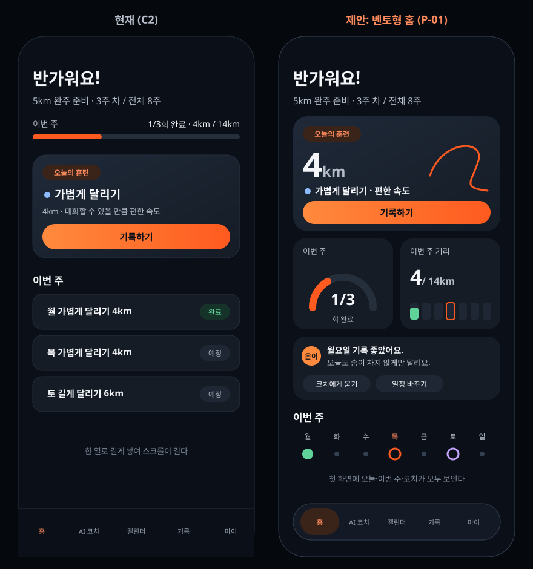
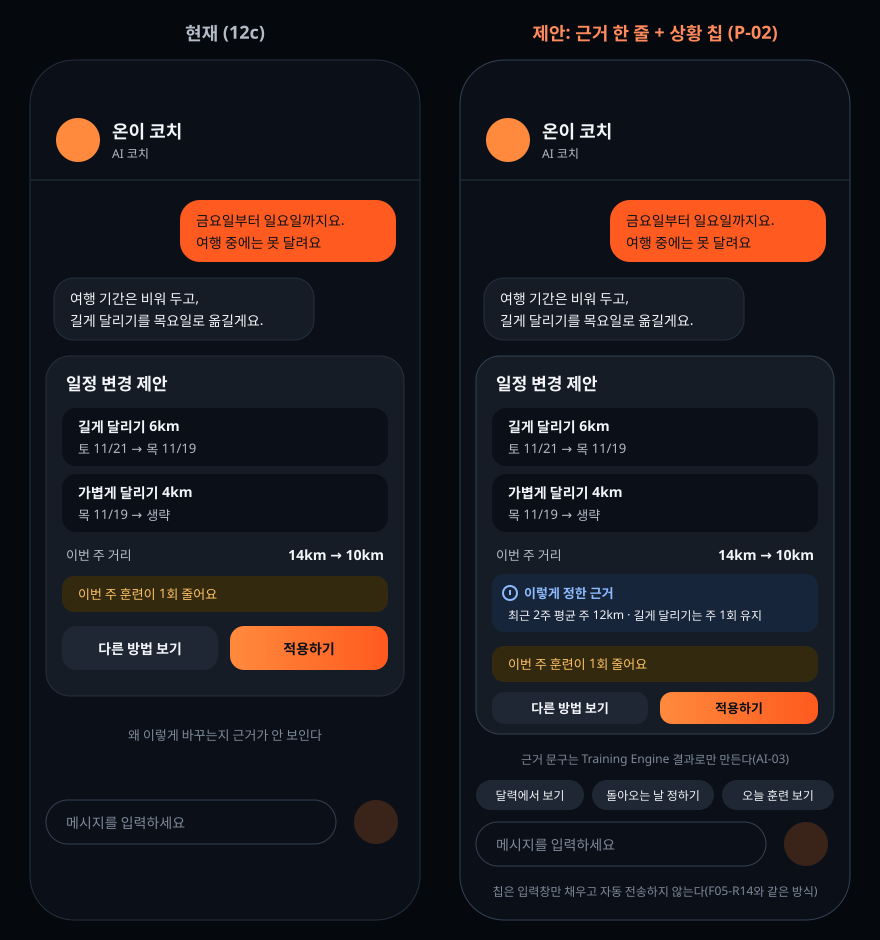
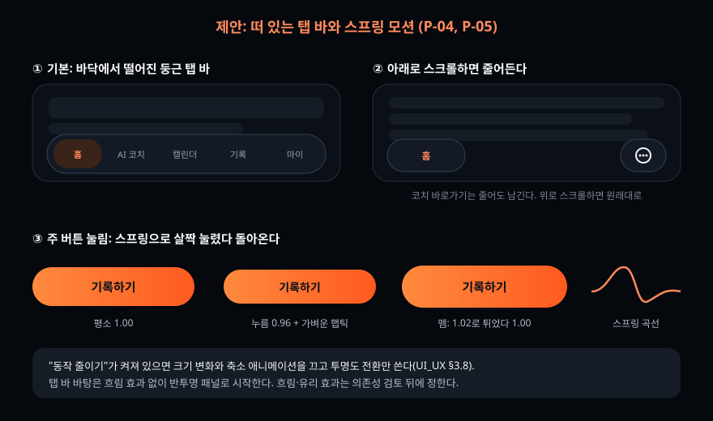
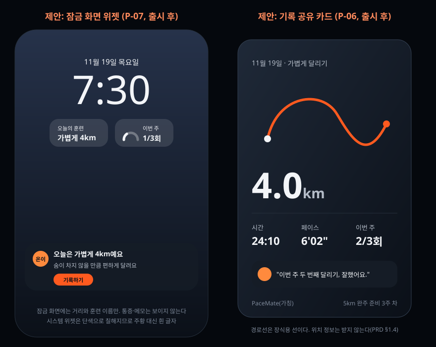

# 디자인 동향 조사와 적용 제안 (2026-11)

| 항목 | 내용 |
|---|---|
| 작성일 | 2026-11-20 |
| 작성 | Claude Code (개발자 요청) |
| 상태 | **제안**. 이 문서는 아무것도 확정하지 않는다. 채택한 항목만 `UI_UX.md`를 고친 뒤 구현한다 |
| 기준 | `UI_UX.md` §1.3 설계 기준, §2 디자인 원칙, C2 비주얼 스타일(`T-112`) |

## 요약

- **전면 개편은 필요 없다.** C2(남색 다크 바탕, 주황 포인트 하나, 숫자 중심, 패널 단계, 선 아이콘)는 2026년 흐름(다크 기본, 미니멀, 숫자 중심 대시보드, 접근성 기본값)과 이미 맞는다. 바꾸면 지금까지 맞춘 Figma·토큰·기기 확인을 다시 해야 해서 얻는 것보다 잃는 것이 크다.
- **부분 개선 3가지를 출시 전에 검토할 만하다**: 홈을 벤토형 타일로 정리(P-01), 변경 제안 카드에 기록 근거 한 줄과 상황 칩(P-02), 스프링 모션 토큰(P-05).
- **플랫폼 변화(iOS 26 Liquid Glass, Material 3 Expressive)는 따라가되 흉내 내지 않는다.** 직접 그린 유리 효과 대신 시스템 탭 바를 쓸 수 있는지부터 확인한다(P-04).
- **앱 밖 표면(위젯, 잠금 화면, 공유 카드)은 출시 후**로 둔다(P-06, P-07). 네이티브 확장과 범위 결정이 필요하다.

| ID | 제안 | 권장 시점 | 비용 | 원칙 충돌 |
|---|---|---|---|---|
| P-01 | 홈을 벤토형 타일로 정리 | 출시 전 검토 | 중 | 없음(§2의 5 "카드는 독립된 덩어리에만"과 맞춰 타일 수를 4개로 제한) |
| P-02 | 변경 제안 카드의 근거 한 줄 + 상황 칩 | 출시 전 검토 | 소~중 | 없음. 근거 수치는 Engine 결과만 쓴다(`AI-03`) |
| P-03 | 코치가 기억하는 것 보기 | 출시 후(P1 코치 memory와 함께) | 중 | 없음 |
| P-04 | 떠 있는 탭 바, 스크롤 시 축소 | 출시 전 조사 → 결정 | 소(시스템 탭) / 중(직접 구현) | 흐림 효과는 의존성 검토 필요 |
| P-05 | 스프링 모션과 햅틱 토큰 | 출시 전 | 소 | 없음. "동작 줄이기" 규칙 유지 |
| P-06 | 기록 공유 카드 | 출시 후 | 중 | PRD §1.4 "SNS 피드"와의 경계 확인 필요 |
| P-07 | 잠금 화면 위젯·라이브 액티비티 | 출시 후 | 대 | 없음. 민감 정보 제외 |
| P-08 | 앱 아이콘 레이어(iOS 26 아이콘) | 스토어 준비(`D-A6`) | 소 | 없음 |

---

## 1. 조사 방법과 한계

- 2026-11-20에 웹 검색으로 플랫폼 공식 자료(Apple, Google), 디자인 매체·에이전시의 2026 동향 글, 러닝·피트니스 앱 소식, AI 채팅 UX 자료를 모았다. 출처는 §6에 있다.
- 동향 글 대부분은 에이전시·도구 회사의 블로그라 서로 비슷한 목록을 반복한다. 방향을 보는 자료로만 쓰고, 수치(예: "4배 빠르게 찾는다")는 회사 주장으로 표시했다.
- 경쟁 앱(Strava, Nike Run Club, 런데이, 루핀, 런타인)의 2026년 화면 변화는 공개 자료가 적어 확인하지 못했다. 직접 써 보고 비교하려면 개발자가 앱을 설치해 화면을 모아야 한다.
- 예시 이미지(`docs/design/trends/*.svg`)는 **우리 토큰으로 직접 그린 개념 그림**이다. Figma 시안이 아니고, 다른 앱의 화면을 옮기지 않았다. 채택하면 Figma에서 다시 그린다.

## 2. 2026년 동향

### 2.1 플랫폼 디자인 언어가 바뀌었다

- **iOS 26 Liquid Glass**: 유리처럼 비치고 움직이는 새 재료가 탭 바, 시트, 툴바에 들어갔다. Apple은 새 SDK로 다시 빌드하면 시스템 컨트롤이 자동으로 바뀌고, 앱을 처음부터 다시 만들 필요는 없다고 안내한다. 탭 바는 스크롤하면 줄었다가 위로 올리면 다시 커진다. 앱 아이콘은 앞·중간·뒤 레이어로 나눠 Icon Composer로 만든다.
- **Material 3 Expressive (Android 16)**: 새 버전(M4)이 아니라 Material 3의 확장이다. 스프링 기반 모션, 모양이 바뀌는(morph) 버튼, 더 다양한 모양이 핵심이다. Google은 중요한 요소를 최대 4배 빨리 찾는다고 주장한다(회사 주장).
- **공통점**: 두 플랫폼 모두 "내용 위에 떠 있는 컨트롤 층"과 "물리감 있는 모션"으로 갔다.

### 2.2 AI 코치는 대화 + 카드 + 신뢰 신호로 간다

- 새 AI 러닝 코치 앱들은 대화로 코칭하고, 계획을 매일 조정하고, 숫자의 근거를 실제 기록에 둔다("모든 숫자는 실제 훈련에서 나오거나, 아예 보여 주지 않는다").
- Fitbit의 2026년 1월 개편은 AI 코치가 남긴 "코치 노트"를 사용자가 보고 지울 수 있게 했다. 코치가 무엇을 기억하는지 보여 주는 방식이다.
- 반대 사례도 있다. Runna는 2026년 2월에 계획 변경이 부상을 불렀다는 비판을 받았다. 적응형 계획에는 눈에 보이는 안전장치가 필요하다.
- 생성형 UI 자료들은 대화 안에 **정해진 컴포넌트 목록에서 고른 카드**를 넣고, 화면에 이미 있는 대상에서 바로 AI를 부르는 **인라인 동작**이 채팅보다 찾기 쉽다고 본다. 데이터를 바꾸는 동작에는 확인 단계를 둔다.

우리 앱은 이미 이 방향이다: 정해진 카드 5종, 버튼 승인으로만 변경(`F05-R03`), Engine만 수치를 정함(`AI-03`). 빈 곳은 "왜 이렇게 바꾸는지"가 서버 템플릿 한 줄(UI_UX §7.2의 "이유 한 줄")뿐이라는 점과, 홈·기록에서 코치로 가는 입구가 적다는 점이다.

### 2.3 숫자 중심 벤토 대시보드

- 피트니스 대시보드는 크기가 다른 타일(오늘 목표, 주간 링·게이지, 연속 기록, 추세)을 한 화면에 모으는 벤토 그리드로 정리되는 흐름이다.
- 2026년 대시보드 글들은 사용자에 맞춰 타일 순서를 바꾸는 개인화를 다음 단계로 본다.

우리 홈은 한 열로 오늘 카드 → 매니저 메시지 → 이번 주 목록이 길게 쌓인다. 핵심 숫자(오늘 거리, 이번 주 횟수·거리)는 이미 있으므로 배치만 바꾸면 된다.

### 2.4 앱 밖에서 보는 정보

- iOS 라이브 액티비티와 잠금 화면 위젯은 "진행 중인 일의 요약 몇 가지"를 보여 주는 곳이다. Apple은 자세한 내용이나 많은 동작을 넣지 말고, 민감한 정보는 잠금 화면에 무난한 요약만 보이라고 안내한다. 운동이 끝난 뒤 잠깐 요약을 남기는 방식도 쓴다.
- 러닝 앱에서는 기록을 이미지 카드로 만들어 공유하는 기능이 흔하다(조사 자료에는 근거가 적어 관찰로만 적는다).

### 2.5 모션, 햅틱, 접근성은 기본값

- 마이크로 인터랙션, 스프링 모션, 햅틱이 여러 동향 목록에 반복된다. 다크 모드와 접근성(포용적 디자인)은 "트렌드"가 아니라 기본값으로 다뤄진다.
- 우리 토큰은 시간과 곡선(§3.8)만 있고 스프링과 햅틱 기준이 없다.

### 2.6 한국 시장

- 토스는 자체 디자인 시스템(TDS)으로 많은 팀의 화면을 맞춘다. 2026년 8월 홈페이지 개편은 "스크롤만으로 앱을 써 보는 듯한 경험"을 내세웠다. 단순한 화면, 큰 글자, 한 화면 한 가지 일이라는 한국 사용자가 익숙한 기준과 같다.
- 2026년 한국 앱 디자인 동향을 정리한 신뢰할 만한 자료는 찾지 못했다. 경쟁 러닝 앱은 직접 비교가 필요하다(§1).

## 3. 우리 앱과 비교

| 동향 | 우리 앱 지금 | 판단 |
|---|---|---|
| 다크 기본, 미니멀 | C2 남색 다크, 주황 하나 | 맞음. 유지 |
| 숫자 중심 | `display` 숫자, 진행률 | 맞음. 홈 배치만 보완(P-01) |
| 대화 + 정해진 카드 + 승인 | 카드 5종, 버튼 승인 | 맞음. 근거 보강(P-02) |
| 코치가 기억하는 것 공개 | 없음(코치 memory는 P1) | 출시 후(P-03) |
| 떠 있는 컨트롤, 스크롤 시 축소 | 바닥 고정 탭 바 | 조사 후 결정(P-04) |
| 스프링 모션, 햅틱 | 시간·곡선 토큰만 | 토큰 추가(P-05) |
| 위젯, 라이브 액티비티, 공유 | 없음 | 출시 후(P-06, P-07) |
| 접근성 기본값 | 대비 테스트, 동작 줄이기 규칙 | 맞음. 유지 |
| 유리 효과(글래스모피즘) | 쓰지 않음 | 직접 그리지 않는다. 시스템 컨트롤이 주는 만큼만 |

## 4. 적용 제안

### P-01 홈을 벤토형 타일로 정리

- **무엇**: 지금 홈의 내용은 그대로 두고 배치를 바꾼다. 오늘 훈련(큰 거리 숫자) → 반원 게이지(이번 주 횟수)와 이번 주 거리 타일 두 개 → 코치 한마디 + 동작 칩 → 요일 줄.
- **왜**: 첫 화면에서 오늘·이번 주·코치가 한 번에 보인다(§2.3). 지금은 이번 주 목록 때문에 스크롤이 길다.
- **지킬 것**: 타일은 4개까지(원칙 5). 주황은 오늘 표시·진행·주 버튼에만. 요일 줄은 색에 더해 모양(채움·테두리)으로 상태를 구분한다(원칙 7). 이번 주 훈련 목록은 요일 줄을 누르면 펼치거나 캘린더로 보낸다.
- **영향**: `UI_UX.md` §6.3, `WeekGauge`·`TodayCard`(§4.3), Figma 10b·11a. 담당 작업은 `T-205`(홈)의 후속이다. API 변경 없음.
- **열린 질문**: 매니저 메시지(서버 문구)와 코치 한마디를 한 타일로 합칠지.

### P-02 변경 제안 카드의 근거 한 줄과 상황 칩

- **무엇**: (1) 지금의 "이유 한 줄"(서버 템플릿) 아래에 기록 근거를 info 색 띠로 보여 준다. 예: "최근 2주 평균 주 12km · 길게 달리기는 주 1회 유지". (2) 카드 아래에 상황에 맞는 칩 2~3개(달력에서 보기, 돌아오는 날 정하기 등)를 둔다. 칩은 입력창만 채우고 자동으로 보내지 않는다(`F05-R14`와 같은 방식).
- **왜**: 2026년 AI 코치의 핵심 경쟁 요소가 신뢰 신호다(§2.2). Runna 사례처럼 "왜 줄였는지"가 안 보이면 불안해진다.
- **지킬 것**: 근거 수치는 Training Engine과 서버 계산 결과만 쓴다. LLM이 만든 숫자를 넣지 않는다(`AI-03`, 구조 규칙 4). 의료 판단처럼 보이는 문구는 쓰지 않는다.
- **영향**: `UI_UX.md` §7.2, `ProposalCard`, `API_SPEC.md`의 제안 객체(근거 필드), PRD `F05` 계열. 서버(`T-403`·`T-406`)와 화면(`T-408`) 모두 바뀐다. 출시 전에 넣으려면 개발자 결정이 필요하다.

### P-03 코치가 기억하는 것 보기 (출시 후)

- **무엇**: 마이 > 코치 화면에 코치가 기억하는 선호(예: "평일 아침에 달려요", "무릎이 가끔 불편해요")를 목록으로 보여 주고 지울 수 있게 한다.
- **왜**: Fitbit 코치 노트처럼 기억을 보여 주고 지우게 하면 개인화가 무섭지 않다(§2.2).
- **조건**: `URGENT_PRE_MVP.md` P1의 "코치 memory"와 함께 설계한다. 채팅 본문을 로그에 남기지 않는 규칙(`F11-R04`)과 저장 범위를 먼저 정한다.

### P-04 떠 있는 탭 바와 스크롤 시 축소 / P-05 스프링 모션과 햅틱

- **P-04 무엇**: 탭 바를 바닥에서 띄운 둥근 패널로 바꾸고, 아래로 스크롤하면 현재 탭과 코치 바로가기만 남게 줄인다.
- **P-04 먼저 조사할 것**: Expo SDK 58의 expo-router 네이티브 탭이 iOS 26 시스템 탭 바(Liquid Glass)와 Android 기본 탭을 그대로 쓰게 해 주는지. 쓸 수 있으면 직접 그리지 않고 시스템 것을 쓴다(Apple 권고와 같고 코드가 적다). 안 되면 흐림 효과 없는 반투명 패널로만 직접 만든다. 흐림·유리 효과용 패키지는 의존성 추가 제안을 따로 한다(AGENTS "범위").
- **P-05 무엇**: §3.8에 스프링 토큰(예: 눌림 0.96 → 뗌 1.02 → 1.00)과 햅틱 기준(주 버튼 확정, 제안 적용, 기록 저장에만 가벼운 햅틱)을 더한다. "동작 줄이기"가 켜져 있으면 크기 변화를 끄고 투명도 전환만 쓰는 규칙은 그대로다.
- **영향**: `UI_UX.md` §3.8, §4.1(`Button`), §5(탭 구조), `apps/mobile/src/ui/tokens.ts`. 햅틱은 `expo-haptics` 추가가 필요하면 의존성 제안을 먼저 한다.

### P-06 기록 공유 카드 / P-07 잠금 화면 위젯 (출시 후)

- **P-06 무엇**: 기록 저장 완료 화면(11d)에서 거리·시간·페이스·이번 주 진행과 코치 한마디를 담은 이미지 카드를 만들어 OS 공유 창으로 보낸다. 경로선은 장식이다. 위치 정보는 받지 않는다(자체 GPS 트래킹은 PRD §1.4 제외).
- **P-06 확인할 것**: PRD §1.4가 "SNS 피드"를 뺐다. 앱 안 피드가 아니라 OS 공유라 경계 밖으로 보이지만, 범위 결정은 개발자가 한다. 통증 메모는 카드에 넣지 않는다.
- **P-07 무엇**: 잠금 화면 위젯(오늘의 훈련, 이번 주 횟수)과 훈련 당일 알림형 요약. Apple 안내대로 요약만 보이고 통증·메모는 넣지 않는다. 시스템 위젯은 단색으로 칠해질 수 있어 주황 대신 흰 글자를 기준으로 그린다.
- **P-07 조건**: iOS 위젯 확장(네이티브 타깃)과 Android 위젯이 필요하다. Expo 설정 플러그인과 개발 빌드 변경이 따르므로 `T-504` 뒤에 별도 작업으로 잡는다.

### P-08 앱 아이콘 레이어

- iOS 26 아이콘은 앞·중간·뒤 레이어로 나누고 단순한 면 모양을 권한다. 서비스명(`D-14`)과 스토어 등록 정보(`D-A6`)를 정할 때 Icon Composer로 레이어 아이콘을 만든다.

## 5. 다음 단계

1. 개발자가 P-01, P-02, P-04, P-05 중 출시 전에 할 것을 고른다. 고르지 않은 것은 출시 후 목록에 둔다.
2. 고른 항목은 `UI_UX.md` §12에 결정 항목(`UX-17`부터)으로 올리고, Figma에서 다시 그린 뒤 `docs/design/screens/`에 참조 이미지를 더한다.
3. 구현은 화면 담당 작업의 후속으로 잡는다(홈 `T-205`, 채팅 `T-408`, 공통 컴포넌트 `T-109`). P-02는 API와 PRD를 먼저 고친다.
4. 경쟁 앱 화면 비교가 필요하면 개발자가 설치해 화면을 모은 뒤 이 문서에 비교 절을 더한다.

## 6. 출처

플랫폼

- [Apple — Adopting Liquid Glass](https://developer.apple.com/documentation/technologyoverviews/adopting-liquid-glass)
- [Apple — Discover how apps are using the new design and Liquid Glass](https://developer.apple.com/design/new-design-gallery-2026)
- [Apple Newsroom — new software design (2025-06)](https://apple.com/newsroom/2025/06/apple-introduces-a-delightful-and-elegant-new-software-design)
- [Apple Developer — Meet with Apple: 새 디자인 적용 세션](https://developer.apple.com/videos/play/meet-with-apple/208)
- [9to5Mac — Apple spotlights third-party apps adopting Liquid Glass](https://9to5mac.com/2025/11/06/apple-spotlights-third-party-apps-adopting-liquid-glass-in-ios-26-and-more/)
- [Apple HIG — Live Activities](https://developer.apple.com/design/human-interface-guidelines/live-activities)
- [9to5Google — Android 16 Material 3 Expressive redesign](https://9to5google.com/2025/05/13/android-16-material-3-expressive-redesign/)
- [Android Authority — Material 3 Expressive features and availability](https://www.androidauthority.com/google-material-3-expressive-features-changes-availability-supported-devices-3556392/)

AI 코치와 러닝 앱

- [Wareable — Inside Runna: plan changes and new features](https://www.wareable.com/running/inside-runna-app-plan-changes-new-features-academic-review-loughborough-stanford-steph-kessell)
- [Android Authority — Fitbit AI coach review](https://www.androidauthority.com/fitbit-ai-coach-3630732/)
- [App Store — Informed Running](https://apps.apple.com/us/app/informed-running/id6785337771)
- [App Store — Daptiv](https://apps.apple.com/us/app/daptiv/id6751173422)
- [ProRun UX case study](https://lorecav.github.io/ux.showcase/prorun.html)

AI 채팅 UX

- [CopilotKit — Generative UI design patterns](https://copilotkit.ai/generative-ui)
- [EL Passion — Generative UI patterns (2026-08)](https://www.elpassion.com/blog/generative-ui-patterns)
- [WeAreTenet — GenUI elements beyond text](https://www.wearetenet.com/updates/genui-elements-ai-chatbots-beyond-text)

모바일 동향, 대시보드

- [Muzli — What's changing in mobile app design in 2026](https://muz.li/blog/whats-changing-in-mobile-app-design-ui-patterns-that-matter-in-2026/)
- [DesignRush — Top mobile app design trends 2026](https://www.designrush.com/agency/mobile-app-design-development/trends/mobile-app-design-trends)
- [Design Studio UI/UX — 13 mobile app UI/UX trends 2026](https://www.designstudiouiux.com/blog/mobile-app-ui-ux-design-trends/)
- [Speculative Chic — Modern dashboard design trends for mobile apps in 2026](https://speculativechic.com/modern-dashboard-design-trends-for-mobile-apps-in-2026/)

한국

- [토스피드 — 서비스 개편, 토스팀 디자이너 인터뷰](https://toss.im/tossfeed/article/toss-designer-interview)
- [토스 뉴스룸 — 홈페이지 전면 개편](https://toss.im/newsroom/toss-new-homepage)
- [디자인 매거진 — 유니콘 스타트업의 결정적 순간(TDS)](https://design.co.kr/article/134476/)
